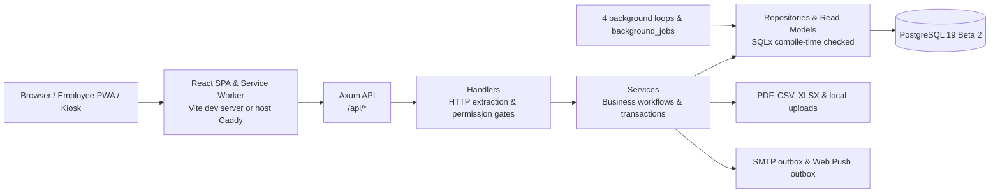

<div align="center">


# Payroll System

**A full-stack payroll, attendance, statutory compliance, and HR workflow platform for Malaysian SMEs.**

[](https://github.com/siewong007/payroll-system/actions/workflows/ci.yml)
[](LICENSE)
[](backend/Cargo.toml)
[](frontend/package.json)
[](backend/Cargo.toml)
[](https://github.com/siewong007/payroll-system/commits)

</div>

## Project Overview 📌

Payroll System (`PayrollMY`) is an academic and portfolio-grade full-stack platform modeling Malaysian SME payroll and HR administration workflows. It combines employee lifecycle management, monthly payroll calculation and four-eyes approvals, statutory contribution modeling (EPF, SOCSO, EIS, PCB, Form EA), QR/WebAuthn/geofenced/network-bound attendance tracking, employee self-service, installable PWA & Web Push notifications, reporting, and production deployment automation.

Built as a React single-page application / PWA backed by a Rust Axum API and PostgreSQL 19 Beta 2 database, it requires independent legal, tax, and security verification before adoption with live organizational data.

## Documentation Index 📚

Each document type lives in a single canonical file:

| Document                                     | Purpose                                                                                         |
| -------------------------------------------- | ----------------------------------------------------------------------------------------------- |
| [docs/architecture.md](docs/architecture.md) | System context, backend layering, 4 background loops, RBAC, PWA/Web Push, and invariants        |
| [docs/database.md](docs/database.md)         | PostgreSQL 19 Beta 2 policy, baseline `1000`–`1001`, migrations `1002`–`1034`, SQLx & backups   |
| [docs/features.md](docs/features.md)         | End-to-end vs conditional capability catalogue and known limitations                            |
| [docs/payroll.md](docs/payroll.md)           | Calculation engine, run lifecycle, statutory gate, permissions, and payroll test suites         |
| [docs/i18n.md](docs/i18n.md)                 | Four-locale architecture (`en`, `ms`, `zh-CN`, `zh-TW`), formatters, terminology, and gates     |
| [docs/legal.md](docs/legal.md)               | Terms of Use, bilingual EN/BM PDPA Notice (Act 709 / A1727), and 2026 Malaysian Statutory Guide |
| [AGENTS.md](AGENTS.md)                       | Unified developer & AI coding agent handbook and CodeGraph workflow                             |
| [CONTRIBUTING.md](CONTRIBUTING.md)           | Setup, architecture rules, SQLx cache regeneration, and PR checks                               |
| [SECURITY.md](SECURITY.md)                   | Vulnerability reporting, security controls, and prototype boundaries                            |
| [CHANGELOG.md](CHANGELOG.md)                 | Release history and unreleased changes                                                          |
| [CODE_OF_CONDUCT.md](CODE_OF_CONDUCT.md)     | Community standards                                                                             |

## Key Features ✨

| Area                      | Implemented capabilities                                                                                                                                                                                                                                         |
| ------------------------- | ---------------------------------------------------------------------------------------------------------------------------------------------------------------------------------------------------------------------------------------------------------------- |
| Authentication & security | In-memory JWT access tokens, rotated `httpOnly` refresh cookies with reuse detection, AES-GCM TOTP 2FA + O(1) backup recovery codes + code sign-in, WebAuthn passkeys, Google OAuth2, Cloudflare Turnstile, session revocation (`/account`), company switching   |
| Roles & user groups       | 8 canonical roles (`super_admin`, `admin`, `manager`, `payroll_admin`, `hr_manager`, `finance`, `exec`, `employee`), additive company-scoped `user_groups`, capability-based `PermissionGuard` routing, `/admin/platform` 2FA policy & health console            |
| Employee management       | Employee CRUD, salary history with `change_type` classification, TP3 records, async CSV/XLSX bulk import (`202` + `/api/jobs/{id}`), portal account provisioning with forced first-login password rotation                                                       |
| Payroll                   | Payroll overview dashboard (`/payroll`), preview with Minimum Wages Order 2024 (RM1,700) & statutory diagnostics, async run processing, four-eyes approval, cancellation, paid-run reversal, `taxable_gross` tracking, bank payment CSV, GL journal preview      |
| Statutory payroll         | Effective-dated `statutory_rule_sets`, KWSP Third Schedule Parts A–F (incl. Oct 2025 2% foreign-worker Part F & s.43(1) age-75 cessation), PERKESO SOCSO & EIS (RM6,000 ceiling), exports, Form EA; production PCB fails closed pending LHDN conformance         |
| Attendance                | Multi-use expiring QR kiosk attendance (`/kiosk#<secret>`), server-verified WebAuthn ("Face ID") check-in, 24h overnight check-out, `none`/`warn`/`enforce` geofencing, `none`/`learn`/`warn`/`enforce` office-network binding, auto-absent catch-up, CSV export |
| Employee portal           | Self-service profile, payslip PDFs, leave requests, expense claims, overtime requests, team calendar, in-app notifications, and attendance history                                                                                                               |
| Approvals                 | Maker-checker leave, claims, overtime, and four-eyes payroll approval workbenches                                                                                                                                                                                |
| Documents & communication | Authorized uploads (`uploaded_files` + magic-byte & single-segment path guards, `404` on denial), expiry tracking, email/letter templates with retryable outbox, SSRF-hardened ICS calendar import                                                               |
| PWA & Web Push            | Installable PWA (`manifest.webmanifest`, `sw.js`, `offline.html`, `OfflineBanner`), iOS/Android/desktop install & notification cards, RFC 8291/8292 VAPID Web Push delivery outbox (`push_subscriptions`, `push_outbox`, `/api/notifications/test-push`)         |
| Localization & UX         | Full four-locale support (`en`, `ms`, `zh-CN`, `zh-TW`), light/dark/system appearance, global command palette (`⌘K`)                                                                                                                                             |
| Legal, PDPA & ops         | In-app `/terms`, `/privacy`, `/compliance` backed by [docs/legal.md](docs/legal.md), 7-year audit trail with automated daily PDPA retention purges, company backup/restore, PostgreSQL 19 Beta 2 migrations, CI & AIC VPS deployment                             |

## Tech Stack 🧰

| Layer                 | Technology                                                                                                                                              |
| --------------------- | ------------------------------------------------------------------------------------------------------------------------------------------------------- |
| Frontend / PWA        | React 19, TypeScript 7, Vite 8, Tailwind CSS 4, React Router 8, TanStack Query 5, i18next 26, Axios, Service Worker + Web Manifest                      |
| Backend               | Rust 2024, Axum 0.8, Tokio, SQLx 0.8, Tower HTTP, `tower_governor`                                                                                      |
| Database              | PostgreSQL 19 Beta 2 (native `uuidv7()`)                                                                                                                |
| Auth, crypto & push   | JWT (HS256 via `aws_lc_rs`), bcrypt, AES-GCM TOTP 2FA, `httpOnly` cookies, WebAuthn (`webauthn-rs`), OAuth2, Turnstile, RFC 8291/8292 Web Push          |
| Documents and exports | `printpdf`, `rust_xlsxwriter`, `calamine`, `zip`, `csv`, `lettre`                                                                                       |
| DevOps                | Docker Compose, GitHub Actions (`main`/`master`), Caddy (`deploy/payrollmy-site.Caddyfile.example`), local verified nightly dumps & watchdog on AIC VPS |

## Architecture



```text
Browser / PWA -> Vite proxy or Cloudflare + Host Caddy -> Axum /api -> handler -> service -> repository -> PostgreSQL
```

Handlers stay thin; business logic and transactions live in services; request-time SQL lives in repositories and read models. See [docs/architecture.md](docs/architecture.md) and [docs/database.md](docs/database.md).

### Production Deployment

GitHub Actions (`ci.yml` → `deploy.yml` / `deploy-backend.yml`) runs on `main` and `master`, rejects superseded commits, builds the Vite SPA to `/opt/payrollmy-site` (served by host Caddy behind Cloudflare; reference config in [deploy/payrollmy-site.Caddyfile.example](deploy/payrollmy-site.Caddyfile.example)), and ships a checksummed `linux/amd64` backend container image (`infra/Dockerfile`) to the AIC VPS alongside PostgreSQL 19 Beta 2. `deploy/payroll-backup.sh` keeps 14 verified local nightly `pg_dump` archives and `deploy/payroll-watchdog.sh` monitors `/api/health/ready` and disk usage.

## Project Structure

```text
payroll-system/
├── backend/
│   ├── migrations/
│   │   ├── 1000_schema.sql      # canonical baseline schema + legacy reconciliation
│   │   ├── 1001_data.sql        # baseline defaults + prototype fixtures; no credentials
│   │   └── 1002..1034_*.sql     # immutable forward migrations (2FA, jobs, ops, statutory, security, manager, push)
│   ├── src/
│   │   ├── core/                # config, auth, permissions, Turnstile, SSRF & path guards, redaction
│   │   ├── handlers/            # thin Axum HTTP handlers
│   │   ├── models/              # DTOs and domain structs
│   │   ├── repositories/        # SQLx data access + reads/ projections
│   │   ├── routes/              # all /api route definitions
│   │   ├── services/            # business logic, statutory engine, email & push outbox
│   │   └── tests/               # 28 backend unit, property, and integration test modules
│   ├── Cargo.toml
│   └── .sqlx/                   # committed offline query metadata
├── frontend/
│   ├── public/                  # manifest.webmanifest, sw.js, offline.html, icons/, branding/
│   └── src/
│       ├── api/                 # Axios API modules (shared client)
│       ├── components/          # reusable UI, PWA cards, OfflineBanner & layout shells
│       ├── context/             # AuthProvider, ThemeProvider & PwaProvider
│       ├── i18n/                # en, ms, zh-CN, zh-TW locales & serverErrorMap
│       ├── lib/                 # formatters, WebAuthn, PWA helpers, CSV & centralized ROUTES
│       ├── pages/               # route-level feature, admin, portal & legal screens
│       ├── tests/               # 40 Vitest component, parity & unit suites
│       └── types/               # TypeScript domain types
├── infra/                       # backend Dockerfile
├── deploy/                      # production Compose, Caddy example, deploy, backup & watchdog scripts
├── scripts/                     # i18n-scan, audit-ignore check, server error map, VAPID keygen, codegraph
├── docs/
│   ├── architecture.md          # living system architecture
│   ├── database.md              # PostgreSQL 19 policy, migrations & backup/restore guide
│   ├── features.md              # implemented feature catalogue & constraints
│   ├── payroll.md               # payroll engine, lifecycle, statutory gate & testing
│   ├── i18n.md                  # 4-locale workflow, terminology dictionary & CI gates
│   └── legal.md                 # Terms of Use, bilingual PDPA Notice & 2026 Malaysian Statutory Guide
├── docker-compose.yml           # local PostgreSQL 19 Beta 2
├── AGENTS.md
├── CHANGELOG.md
├── CODE_OF_CONDUCT.md
├── CONTRIBUTING.md
├── LICENSE
├── README.md
└── SECURITY.md
```

## Installation Guide 🚀

### Prerequisites

- Docker and Docker Compose
- Rust stable toolchain (pinned in `rust-toolchain.toml` with `rustfmt` and `clippy`)
- Bun 1.3.14 (pinned in `.bun-version`)

### 1. Clone and Configure

```bash
git clone https://github.com/siewong007/payroll-system.git
cd payroll-system
cp .env.example .env
```

The root `.env` is shared by Docker Compose and the backend (`dotenvy` loads it automatically when running from `backend/`).

### 2. Start PostgreSQL and Run Backend & Frontend

```bash
docker compose up -d        # PostgreSQL 19 Beta 2 on 127.0.0.1:5434
```

Backend (terminal 1):

```bash
cd backend
cargo run                   # API on http://localhost:8080, auto-applies migrations
```

Frontend (terminal 2):

```bash
cd frontend
bun install
bun run dev                 # Vite on http://localhost:5173, proxies /api → :8080
```

Verify health:

```bash
curl http://localhost:8080/api/health
# ok
```

## Environment Variables

See [.env.example](.env.example) for full descriptions.

| Variable                                                                                        | Required           | Description                                                                              |
| ----------------------------------------------------------------------------------------------- | ------------------ | ---------------------------------------------------------------------------------------- |
| `POSTGRES_DB`, `POSTGRES_USER`, `POSTGRES_PORT`, `POSTGRES_PASSWORD`                            | Local compose      | Local PostgreSQL 19 Beta 2 settings (default port `5434`)                                |
| `DATABASE_URL`                                                                                  | Backend            | PostgreSQL connection string                                                             |
| `JWT_SECRET`                                                                                    | Backend            | Secret used to sign HS256 JWTs                                                           |
| `TOTP_ENCRYPTION_KEY`                                                                           | Backend            | Dedicated AES key for stored TOTP 2FA secrets (must differ from `JWT_SECRET`)            |
| `JWT_EXPIRY_HOURS`                                                                              | Backend            | Access token lifetime in hours (defaults to `1`)                                         |
| `RUST_ENV`, `RUST_LOG`, `LOG_FORMAT`                                                            | Optional           | `development`/`production` secret mode, tracing filter, `pretty` or `json` logs          |
| `SERVER_HOST`, `SERVER_PORT`                                                                    | Backend            | Backend bind host and port (`0.0.0.0:8080`)                                              |
| `FRONTEND_URL`, `API_PUBLIC_URL`                                                                | Backend / Optional | Allowed CORS origin & email/link base; optional split API origin for OAuth2 callback     |
| `TRUST_PROXY_HEADERS`                                                                           | Optional           | Trust `X-Forwarded-For` / `X-Real-IP` only behind a sole reverse proxy (default `false`) |
| `TURNSTILE_SECRET_KEY`                                                                          | Optional           | Cloudflare Turnstile secret; unset skips verification in dev/CI                          |
| `WEBAUTHN_RP_ID`, `WEBAUTHN_RP_ORIGIN`                                                          | Backend            | WebAuthn relying party ID and origin URL                                                 |
| `GOOGLE_CLIENT_ID`, `GOOGLE_CLIENT_SECRET`                                                      | Optional           | Google OAuth2 credentials                                                                |
| `SMTP_HOST`, `SMTP_PORT`, `SMTP_USERNAME`, `SMTP_PASSWORD`, `SMTP_FROM_EMAIL`, `SMTP_FROM_NAME` | Optional           | SMTP mail delivery settings                                                              |
| `VAPID_PUBLIC_KEY`, `VAPID_PRIVATE_KEY`, `VAPID_SUBJECT`                                        | Optional           | Web Push VAPID keys (`node scripts/generate-vapid-keys.mjs`; `mailto:` or `https://`)    |
| `VITE_API_URL`, `VITE_TURNSTILE_SITE_KEY`                                                       | Optional frontend  | Split-origin API base URL and Turnstile public site key                                  |

## Create the Initial Administrator

Fresh databases contain no demo users or default passwords. Once migrations have run, create the first company and `super_admin` account once:

```bash
cd backend
export BOOTSTRAP_COMPANY_NAME="Example Company Sdn Bhd"
export BOOTSTRAP_ADMIN_NAME="System Administrator"
export BOOTSTRAP_ADMIN_EMAIL="admin@example.com"
read -s BOOTSTRAP_ADMIN_PASSWORD && export BOOTSTRAP_ADMIN_PASSWORD
cargo run --bin bootstrap_admin
unset BOOTSTRAP_ADMIN_PASSWORD
```

## API Endpoint Overview 🔌

All backend routes live in `backend/src/routes/mod.rs` under `/api`. Most endpoints require `Authorization: Bearer <access-token>`.

| Module                      | Representative endpoints                                                                                                                                                                                                                                                                                 |
| --------------------------- | -------------------------------------------------------------------------------------------------------------------------------------------------------------------------------------------------------------------------------------------------------------------------------------------------------- |
| Health                      | `GET /api/health`, `GET /api/health/ready`                                                                                                                                                                                                                                                               |
| Auth & 2FA                  | `POST /api/auth/login`, `POST /api/auth/login/code`, `POST /api/auth/2fa/verify`, `POST /api/auth/refresh`, `POST /api/auth/logout`, `PUT /api/auth/change-password`, `PUT /api/auth/switch-company`                                                                                                     |
| Passkeys, OAuth2 & sessions | `POST /api/auth/passkey/register/begin`, `POST /api/auth/passkey/discoverable/begin`, `GET /api/auth/oauth2/providers`, `GET /api/auth/oauth2/google/callback`, `GET/DELETE /api/auth/sessions`                                                                                                          |
| Admin, platform & groups    | `GET/POST /api/admin/companies`, `GET/POST /api/admin/users`, `POST /api/admin/users/{id}/2fa/reset`, `GET/PUT /api/admin/platform/2fa-policy`, `GET /api/admin/platform/health`, `GET/POST /api/user-groups`, `GET /api/auth/permissions/matrix`                                                        |
| Employees & imports         | `GET/POST /api/employees`, `GET/PUT/DELETE /api/employees/{id}`, `GET /api/employees/{id}/salary-history`, `POST /api/employees/{id}/tp3`, `POST /api/employees/import/validate`, `POST /api/employees/import/confirm`                                                                                   |
| Background jobs             | `GET /api/jobs/{id}` (polls async payroll processing and bulk employee imports)                                                                                                                                                                                                                          |
| Payroll & entries           | `GET /api/payroll/overview`, `POST /api/payroll/preview`, `POST /api/payroll/run` (`202`), `GET /api/payroll/runs/{id}`, `PUT /api/payroll/runs/{id}/{submit-approval,approve,return,lock,cancel,reverse}`, `GET /api/payroll/runs/{id}/{payment-file,journal-preview}`, `GET/POST /api/payroll/entries` |
| Portal & uploads            | `GET /api/portal/profile`, `GET /api/portal/payslips`, `GET/POST /api/portal/leave/requests`, `GET/POST /api/portal/claims`, `GET/POST /api/portal/overtime`, `POST /api/uploads`, `GET /api/uploads/{filename}`                                                                                         |
| Notifications & Web Push    | `GET /api/notifications`, `GET /api/notifications/count`, `PUT /api/notifications/read-all`, `GET /api/notifications/push-config`, `POST/DELETE /api/notifications/subscriptions`, `POST /api/notifications/test-push`                                                                                   |
| Approvals                   | `GET /api/approvals/pending-count`, `GET/POST /api/approvals/{leave,claims,overtime}`, `PUT /api/approvals/{leave,claims,overtime}/{id}/{approve,reject,cancel}`                                                                                                                                         |
| Attendance, kiosk & network | `POST /api/attendance/qr/generate`, `POST /api/attendance/kiosk/qr`, `POST /api/attendance/check-in/qr`, `POST /api/attendance/check-in/face-id/begin`, `POST /api/attendance/check-out`, `POST /api/attendance/absent-run`, `GET /api/attendance/{summary,export}`, `GET/POST /api/attendance/networks` |
| Calendar, teams & schedules | `GET/POST /api/calendar/holidays`, `POST /api/calendar/import-ics`, `GET/POST /api/teams`, `GET/PUT /api/work-schedules/default`, `GET/POST /api/geofence/locations`                                                                                                                                     |
| Documents, email & reports  | `GET/POST /api/documents`, `GET/POST /api/email/templates`, `POST /api/email/send`, `GET /api/dashboard/summary`, `GET /api/reports/{payroll-summary,leave,claims,statutory,ea-form}`, `GET /api/audit-logs`, `GET/POST /api/admin/backup/{export,import}`                                               |

## Legal, Privacy (PDPA) & Malaysian Statutory Compliance ⚖️

All legal and compliance documentation lives in [docs/legal.md](docs/legal.md) and is rendered in-app at `/terms`, `/privacy`, and `/compliance`:

- **[Terms and Conditions of Use](docs/legal.md#part-i-terms-and-conditions-of-use)** — Employer (Data Controller) and User obligations under Malaysian law.
- **[Privacy Policy & Bilingual PDPA Notice](docs/legal.md#part-ii-privacy-policy-and-pdpa-notice)** — bilingual English & Bahasa Malaysia Section 7 notice aligned with the _Personal Data Protection Act 2010 (Act 709)_ and _Personal Data Protection (Amendment) Act 2024 (Act A1727)_ (DPO governance, 72-hour data breach notification, data portability, WebAuthn biometric boundary, Web Push disclosures, and retention schedules).
- **[2026 Malaysian Statutory Compliance Guide](docs/legal.md#part-iii-malaysian-statutory-compliance-guide-2026)** — maps _Employment Act 1955_ (+ May 2025 Sabah/Sarawak alignment), _Minimum Wages Order 2024_ (RM1,700/month), _EPF Act 1991_ Third Schedule Parts A–F (incl. Oct 2025 2% foreign-worker Part F & s.43(1) age-75 cessation), _PERKESO Act 4 & Act 800_ (RM6,000 ceiling), _Income Tax Act 1967_ (YA 2025/2026 reliefs, Form EA, MyTax e-PCB Plus), and _HRD Corp Act 612_.

## Roadmap and Future Improvements 🗺️

- **LHDN & Official Statutory Schedules:** Import verified official 2026 KWSP (Parts A–F) and PERKESO (RM6,000 ceiling, foreign-worker & _Lindung 24 Jam_) schedules, complete LHDN computerised-MTD conformance vectors (incl. TP1 monthly relief claims), and add employee-level PERKESO entry-age/prior-contribution fields.
- **Malaysian Statutory Filings & HR Depth:** Implement Form E + CP8D, CP22 / CP22A notifications, batch & employee-portal EA forms, HRD Corp (Act 612) automated levy lines, year-end leave carry-forward UI & transaction fixes, per-employee work-schedule CRUD, leave-type tenure bands, payroll-group CRUD, document-expiry & probation alerts, and offboarding final-settlement workflows.
- **API & Testing Tooling:** Publish and drift-check an OpenAPI 3.1 contract with generated TypeScript types, and add end-to-end Playwright browser journeys alongside external error-monitoring integration.
- **Scale & Ops:** Add kiosk/geofence-site recording on attendance records, off-cycle supplemental payroll runs, distributed job leases for multi-replica deployments, and optional off-host encrypted backup replication.

## Limitations

- Distributed under the [MIT License](LICENSE) as an academic/portfolio system; independent legal, tax, and security verification is required before live organizational adoption.
- Bundled `1001_data.sql` statutory rows are unverified academic fixtures; production payroll fails closed until official KWSP/PERKESO schedules are verified and automatic PCB passes LHDN conformance.
- SMTP email, Google OAuth2, WebAuthn origins, Cloudflare Turnstile, and VAPID Web Push require environment-specific configuration.
- "Face ID" attendance uses device-local W3C WebAuthn assertions and is not a server-side facial recognition service.
- File uploads reside on the API container's local disk rather than external object storage, and in-process background jobs assume a single active API instance.

## Contributing

Contributions are welcome. Read [CONTRIBUTING.md](CONTRIBUTING.md) before opening an issue or pull request, and run the unified checks from the repo root:

```bash
bun install                 # installs Husky + lint-staged pre-commit hooks
bun run format:check
bun run lint                # cargo clippy, eslint, and i18n-scan --ci
bun run typecheck
bun run test                # backend cargo test + frontend Vitest suite
bun run build
```

## License

Licensed under the [MIT License](LICENSE).
