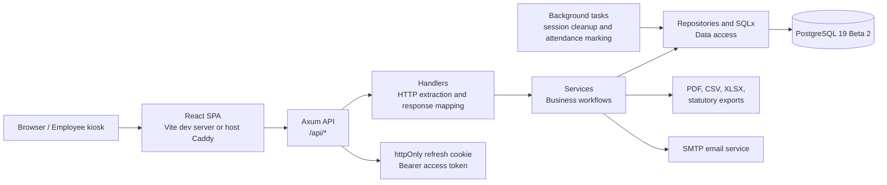
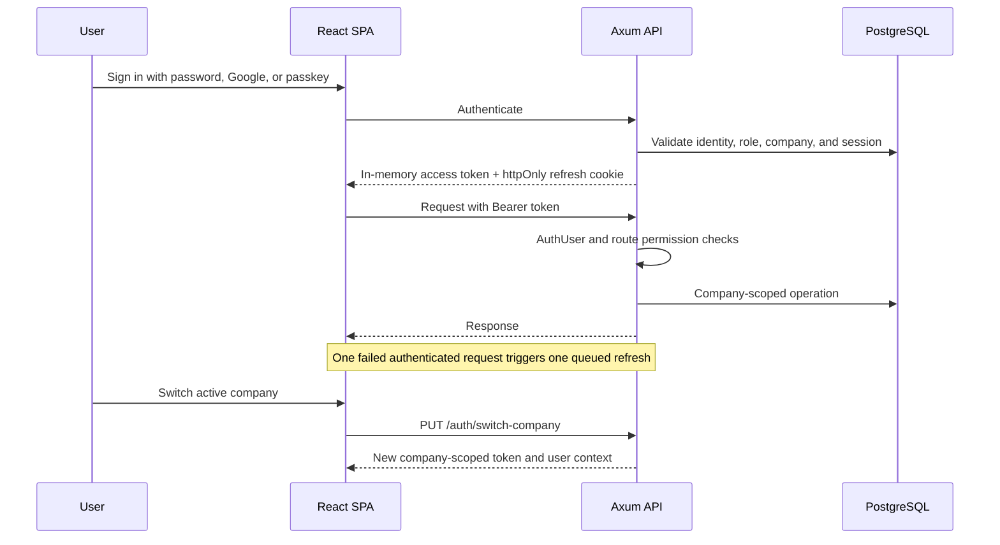
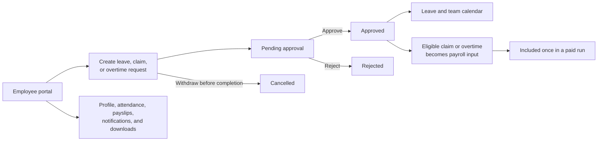
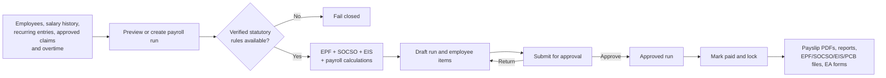
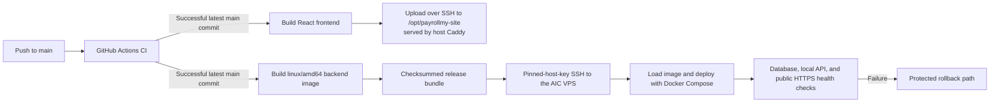

<div align="center">


# Payroll System

**A full-stack payroll and HR workflow system for small and medium-sized enterprises.**

[](https://github.com/siewong007/payroll-system/actions/workflows/ci.yml)
[](LICENSE)
[](backend/Cargo.toml)
[](frontend/package.json)
[](backend/Cargo.toml)
[](https://github.com/siewong007/payroll-system/commits/main)

</div>

## Project Overview 📌

Payroll System is an academic full-stack project that models common payroll and HR administration workflows for Malaysian SMEs. It provides employee management, monthly payroll processing, statutory contribution calculations, approval workflows, attendance tracking, employee self-service, reporting, and basic infrastructure automation.

The system is built as a React single-page application backed by a Rust Axum API and PostgreSQL database. It is suitable for a final-year project, portfolio demonstration, or software engineering case study. It should be evaluated as a learning and prototype system unless it has been independently reviewed for a real organization.

## Problem Statement

Many SMEs manage payroll, attendance, leave, claims, and statutory records across spreadsheets, messaging apps, and manual documents. This creates duplicated data entry, limited auditability, inconsistent approval records, and a higher risk of payroll errors. A centralized system can make these workflows more traceable and easier to review, while also demonstrating how modern web technologies can be applied to business process automation.

## Project Objectives

- Design a centralized payroll and HR workflow platform for SME daily operations.
- Implement role-based access for administrators, payroll staff, finance users, executives, and employees.
- Model payroll calculations with effective-dated EPF, SOCSO, EIS, and PCB data, guarded so unverified statutory rules cannot silently reach a production payroll run.
- Provide employee self-service features for payslips, leave, claims, overtime, attendance, and notifications.
- Record operational events through audit logs and approval states.
- Demonstrate a maintainable full-stack architecture using Rust, React, PostgreSQL, and Docker.

## Key Features ✨

| Area                      | Implemented capabilities                                                                                                                                                                                                                                                                |
| ------------------------- | --------------------------------------------------------------------------------------------------------------------------------------------------------------------------------------------------------------------------------------------------------------------------------------- |
| Authentication & security | JWT access tokens, httpOnly refresh cookies, TOTP 2FA with backup recovery codes & code sign-in, WebAuthn passkeys, Google OAuth2 sign-in & linking, Cloudflare Turnstile bot protection, session management, multi-company switching                                                   |
| User, role & group access | Super admin company/user management, additive company-scoped user groups, capability-based `PermissionGuard` routing, strict company-scoped data access                                                                                                                                 |
| Employee management       | Employee CRUD, salary history with change classification, TP3 records, background bulk CSV/XLSX import validation/confirmation, portal account provisioning                                                                                                                             |
| Payroll                   | Payroll overview dashboard, preview with diagnostics (incl. Minimum Wages Order 2024 RM1,700 check), background run processing, four-eyes approval, cancellation, paid-run reversal, bank payment CSV, GL journal preview                                                               |
| Statutory payroll         | Source-linked rule tables (`statutory_rule_sets`), KWSP Third Schedule Parts A–F (incl. Oct 2025 2% foreign-worker Part F & s.43(1) age-75 cessation), PERKESO SOCSO & EIS (RM6,000 ceiling), statutory exports, and Form EA; production PCB stays fail-closed pending LHDN conformance |
| Attendance                | Multi-use expiring QR kiosk attendance, server-verified WebAuthn ("Face ID") check-in, overnight check-out, `none`/`warn`/`enforce` geofencing, `none`/`learn`/`warn`/`enforce` office-network binding, self-healing auto-absent catch-up, summaries, CSV export                        |
| Employee portal           | Self-service profile, payslip PDFs, leave requests, expense claims, overtime requests, team calendar, notifications, attendance history                                                                                                                                                 |
| Approvals                 | Leave, claims, overtime, and four-eyes payroll lifecycle approval workbenches                                                                                                                                                                                                           |
| Documents and letters     | Per-user authorized file uploads/downloads (`uploaded_files` + magic-byte & path guards), categories, expiry tracking, email/letter templates, SSRF-hardened ICS import                                                                                                                 |
| Internationalization & UX | Full four-locale support (`en`, `ms`, `zh-CN`, `zh-TW`), light/dark/system appearance, global command palette (`⌘K`)                                                                                                                                                                    |
| Legal, PDPA & compliance  | In-app & documented [Terms & Conditions](docs/legal/terms-and-conditions.md), bilingual [Privacy & PDPA Notice](docs/legal/privacy-and-pdpa-notice.md), and [2026 Malaysian Statutory Guide](docs/legal/malaysian-statutory-compliance.md)                                              |
| Reporting, audit & ops    | Workspace & payroll dashboards, statutory/HR reports, 7-year audit trail with automated daily PDPA retention purges, company backup/restore, PostgreSQL 19 Beta 2 migrations, CI & VPS deployment                                                                                       |

See the [implemented feature catalogue](docs/features.md) for end-to-end status,
configuration requirements, and known constraints, and [docs/legal/](docs/legal/malaysian-statutory-compliance.md)
for Terms of Use, bilingual PDPA governance, and 2025–2026 Malaysian statutory alignment.

## Tech Stack 🧰

| Layer                 | Technology                                                                                                                        |
| --------------------- | --------------------------------------------------------------------------------------------------------------------------------- |
| Frontend              | React 19, TypeScript 7, Vite 8, Tailwind CSS 4, React Router 8, TanStack Query 5, i18next, Axios                                  |
| Backend               | Rust 2024, Axum 0.8, Tokio, SQLx 0.8, Tower HTTP, tower-governor                                                                  |
| Database              | PostgreSQL 19 Beta 2 (native `uuidv7()`)                                                                                          |
| Auth and security     | JWT (HS256), bcrypt, AES-GCM TOTP 2FA, httpOnly cookies, WebAuthn (`webauthn-rs`), OAuth2, Cloudflare Turnstile, `tower-governor` |
| Documents and exports | printpdf, rust_xlsxwriter, calamine, csv, lettre                                                                                  |
| DevOps                | Docker Compose, GitHub Actions, local encrypted nightly backups & Caddy on AIC VPS behind Cloudflare                              |

## Architecture



### Request Flow

```text
Browser -> Vite proxy or Cloudflare + Caddy -> Axum /api -> handler -> service -> repository -> PostgreSQL
```

Handlers are intended to stay thin. Business rules live in services, while database access is organized in repositories and SQLx-backed read modules.

The detailed living design is in [docs/architecture.md](docs/architecture.md),
and the schema/version contract is in [docs/database.md](docs/database.md).

## How the System Works

### Authentication, authorization, and company scope



The access token is held in memory; the refresh token remains in an httpOnly
cookie and is rotated by the backend. Concurrent requests share one refresh
attempt rather than creating a refresh storm. The selected company and role are
carried in the re-issued access token, but handlers and services still enforce
company ownership and permissions. Payroll-sensitive routes additionally deny
the read-mostly `exec` role.

### Attendance

1. An administrator selects the company attendance method and configures kiosk
   credentials, office locations, geofences, or approved office networks.
2. A kiosk requests a QR using its own revocable credential. Generating a new
   token revokes the previous token; the displayed QR is multi-use by employees
   during the server-provided TTL.
3. An employee checks in with QR or the configured Face ID flow. The service
   validates the employee, company, token or ceremony, and any enabled location
   or network policy before recording attendance and audit evidence.
4. Check-out closes the most recent open attendance record within 24 hours, so
   overnight shifts are not constrained by a calendar-day boundary.
5. Administrators can correct or enter records manually, view per-employee
   summaries, and export filtered CSV data. Employees see their own current and
   historical attendance in the portal.
6. The hourly background task marks absences around 12:30 PM in the company
   timezone while skipping approved leave and public holidays; an authorized
   manual absent run uses the same rules.

Office-network observations are evidence, not automatic configuration changes:
candidate networks must be corroborated and explicitly approved before they can
be enforced.

### Employee self-service and approvals



Employees use the portal shell for their own records; administrators and
approvers use the management shell. Approval services prevent ordinary users
from approving their own requests, enforce company ownership, and record audit
events. Approved claims and overtime are selected by an eligible payroll run
and are not paid twice. Payslips become available through the portal after the
payroll lifecycle permits them.

### Payroll, reporting, and statutory outputs



Only one active run is allowed for a company, payroll group, year, and month.
The payroll engine assembles source data inside a transaction and preflights
effective-dated, source-linked statutory rules. Unverified academic fixtures
cannot silently reach a production calculation. Automatic PCB remains disabled
until the calculator passes LHDN computerised-MTD conformance; authorized users
can follow the supported manual workflow. Once paid, a run is locked against
ordinary mutation and feeds dashboards, reports, payslips, and statutory
exports.

### Production deployment



Production cannot be deployed manually from an untested revision. Separate
frontend and backend workflows run only after successful push-triggered CI on
`main`, reject superseded commits, and deploy the exact tested SHA. The frontend
is uploaded over SSH to `/opt/payrollmy-site` and served by the host Caddy
behind Cloudflare. The backend image is transferred directly to the same AIC
VPS—there is no registry in this path—then started beside PostgreSQL
19 Beta 2 with Docker Compose. The host reverse proxy is the only public route
to Axum; PostgreSQL is not exposed on a host port.

For endpoint-level coverage and known constraints, see
[docs/features.md](docs/features.md). Operational details live alongside the
workflows in [.github/workflows](.github/workflows), [deploy](deploy), and
[infra](infra).

## Project Structure

```text
payroll-system/
├── backend/
│   ├── migrations/
│   │   ├── 1000_schema.sql      # canonical baseline schema + legacy reconciliation
│   │   ├── 1001_data.sql        # baseline defaults + prototype fixtures; no credentials
│   │   └── 1002..1030_*.sql     # immutable forward migrations (2FA, jobs, ops, statutory, security)
│   ├── src/
│   │   ├── core/                # config, auth, permissions, Turnstile, SSRF & path guards
│   │   ├── handlers/            # thin Axum HTTP handlers
│   │   ├── models/              # DTOs and domain structs
│   │   ├── repositories/        # SQLx data access + reads/ projections
│   │   ├── routes/              # all /api route definitions
│   │   ├── services/            # business logic and statutory orchestration
│   │   └── tests/               # backend unit, property, and integration tests
│   ├── Cargo.toml
│   └── .sqlx/                   # committed offline query metadata
├── frontend/
│   ├── public/branding/         # project logo assets
│   └── src/
│       ├── api/                 # Axios API modules (shared client)
│       ├── components/          # reusable UI & layout shells
│       ├── context/             # auth & theme providers
│       ├── i18n/                # en, ms, zh-CN, zh-TW locales & serverErrorMap
│       ├── lib/                 # shared helpers, formatters, WebAuthn & centralized ROUTES
│       ├── pages/               # route-level feature & legal screens
│       ├── tests/               # Vitest component, parity & unit suites
│       └── types/               # TypeScript domain types
├── infra/                       # backend Dockerfile
├── deploy/                      # production Docker Compose & deployment scripts
├── docs/                        # architecture, database, payroll, i18n & legal docs
│   ├── legal/                   # Terms, bilingual PDPA Notice & Malaysian Statutory Guide
│   └── refactor/                # full-repo audit & phase progress log
├── docker-compose.yml           # local PostgreSQL 19 Beta 2
├── README.md
├── SECURITY.md
├── CONTRIBUTING.md
└── LICENSE
```

## Installation Guide 🚀

### Prerequisites

- Docker and Docker Compose
- Rust stable toolchain (pinned in `rust-toolchain.toml` with `rustfmt` and `clippy`)
- Bun 1.3.14 (pinned in `.bun-version`)

### 1. Clone the Repository

```bash
git clone https://github.com/siewong007/payroll-system.git
cd payroll-system
```

### 2. Configure Environment Files

```bash
cp .env.example .env
```

The root `.env` is shared by Docker Compose and the backend. `dotenvy` finds it
when `cargo run` is started from the `backend/` directory, so a duplicate
`backend/.env` is neither needed nor recommended.

### 3. Start Local Services

```bash
docker compose up -d
```

This starts PostgreSQL 19 Beta 2 on `127.0.0.1:5434`. The non-default host port avoids
collisions with other local PostgreSQL projects. The backend automatically
applies the schema and reference-data migrations on startup.

PostgreSQL 19 Beta 2 is a pre-release testing build. Keep valuable data backed up and use a
major-version upgrade or dump/restore when moving an existing PostgreSQL volume to it.

### 4. Run the Backend

```bash
cd backend
cargo run
```

The API starts at `http://localhost:8080`.

### 5. Run the Frontend

Open a second terminal:

```bash
cd frontend
bun install
bun run dev
```

The frontend starts at `http://localhost:5173` and proxies `/api` requests to the backend.

### 6. Verify the Setup

```bash
curl http://localhost:8080/api/health
```

Expected response:

```text
ok
```

## Environment Variables

The main example file is [.env.example](.env.example).

| Variable                  | Required          | Description                                                                              |
| ------------------------- | ----------------- | ---------------------------------------------------------------------------------------- |
| `POSTGRES_DB`             | Local compose     | PostgreSQL database name                                                                 |
| `POSTGRES_USER`           | Local compose     | PostgreSQL username                                                                      |
| `POSTGRES_PORT`           | Local compose     | PostgreSQL host port (defaults to `5434`)                                                |
| `POSTGRES_PASSWORD`       | Local compose     | PostgreSQL password                                                                      |
| `DATABASE_URL`            | Backend           | PostgreSQL connection string                                                             |
| `JWT_SECRET`              | Backend           | Secret used to sign HS256 JWTs                                                           |
| `TOTP_ENCRYPTION_KEY`     | Backend           | Dedicated AES key for stored TOTP 2FA secrets (must differ from `JWT_SECRET`)            |
| `JWT_EXPIRY_HOURS`        | Backend           | Access token lifetime in hours (defaults to `1`)                                         |
| `RUST_ENV`                | Optional          | Runtime environment (`development` default; `production` enforces strict secret checks)  |
| `RUST_LOG`                | Backend           | Rust tracing/logging filter                                                              |
| `LOG_FORMAT`              | Optional          | `pretty` (default) or `json` structured container telemetry                              |
| `SERVER_HOST`             | Backend           | Backend bind host                                                                        |
| `SERVER_PORT`             | Backend           | Backend bind port                                                                        |
| `FRONTEND_URL`            | Backend           | Allowed CORS frontend origin and email link base URL                                     |
| `API_PUBLIC_URL`          | Optional          | Public API origin when split from `FRONTEND_URL` (OAuth2 redirect)                       |
| `TRUST_PROXY_HEADERS`     | Optional          | Trust `X-Forwarded-For` / `X-Real-IP` only behind a sole reverse proxy (default `false`) |
| `TURNSTILE_SECRET_KEY`    | Optional          | Cloudflare Turnstile secret; unset skips verification in dev/CI                          |
| `WEBAUTHN_RP_ID`          | Backend           | WebAuthn relying party ID                                                                |
| `WEBAUTHN_RP_ORIGIN`      | Backend           | WebAuthn origin URL                                                                      |
| `GOOGLE_CLIENT_ID`        | Optional          | Google OAuth2 client ID                                                                  |
| `GOOGLE_CLIENT_SECRET`    | Optional          | Google OAuth2 client secret                                                              |
| `SMTP_HOST`               | Optional          | SMTP server hostname                                                                     |
| `SMTP_PORT`               | Optional          | SMTP server port                                                                         |
| `SMTP_USERNAME`           | Optional          | SMTP username                                                                            |
| `SMTP_PASSWORD`           | Optional          | SMTP password                                                                            |
| `SMTP_FROM_EMAIL`         | Optional          | Sender email address                                                                     |
| `SMTP_FROM_NAME`          | Optional          | Sender display name                                                                      |
| `VITE_API_URL`            | Optional frontend | External API base URL when not using the Vite proxy                                      |
| `VITE_TURNSTILE_SITE_KEY` | Optional frontend | Cloudflare Turnstile site key for production builds                                      |

## Create the Initial Administrator

The database deliberately contains no demo users or known password. After the
backend migrations have run, create the first company and super administrator
once with the bootstrap command:

```bash
cd backend
export BOOTSTRAP_COMPANY_NAME="Example Company Sdn Bhd"
export BOOTSTRAP_ADMIN_NAME="System Administrator"
export BOOTSTRAP_ADMIN_EMAIL="admin@example.com"
read -s BOOTSTRAP_ADMIN_PASSWORD && export BOOTSTRAP_ADMIN_PASSWORD
cargo run --bin bootstrap_admin
unset BOOTSTRAP_ADMIN_PASSWORD
```

The command enforces the application password policy, serializes concurrent
attempts, and refuses to run after an active super administrator exists. Do not
put bootstrap credentials in migration files or commit them to `.env`.

## Usage Examples

### Log in

```bash
curl -s -X POST http://localhost:8080/api/auth/login \
  -H "Content-Type: application/json" \
  -d '{"email":"admin@example.com","password":"<your-password>"}'
```

Copy the returned token into authenticated requests:

```bash
curl -s http://localhost:8080/api/employees \
  -H "Authorization: Bearer <access-token>"
```

### Process a Payroll Run

```bash
curl -s -X POST http://localhost:8080/api/payroll/run \
  -H "Authorization: Bearer <access-token>" \
  -H "Content-Type: application/json" \
  -d '{
    "payroll_group_id": "<payroll-group-uuid>",
    "period_year": 2026,
    "period_month": 1,
    "notes": "January payroll test run"
  }'
```

### View Attendance Summary

```bash
curl -s "http://localhost:8080/api/attendance/summary?date_from=2026-01-01&date_to=2026-01-31" \
  -H "Authorization: Bearer <access-token>"
```

## API Endpoint Documentation 🔌

All backend endpoints are nested under `/api`. Most endpoints require `Authorization: Bearer <access-token>` unless marked as public.

| Module                      | Representative endpoints                                                                                                                                                                                                                                                                                                                                             |
| --------------------------- | -------------------------------------------------------------------------------------------------------------------------------------------------------------------------------------------------------------------------------------------------------------------------------------------------------------------------------------------------------------------- |
| Health                      | `GET /api/health`, `GET /api/health/live`, `GET /api/health/ready`                                                                                                                                                                                                                                                                                                   |
| Auth & 2FA                  | `POST /api/auth/login`, `POST /api/auth/2fa/verify`, `POST /api/auth/totp/code-login`, `POST /api/auth/refresh`, `POST /api/auth/logout`, `PUT /api/auth/change-password`, `PUT /api/auth/switch-company`                                                                                                                                                            |
| Passkeys, OAuth2 & sessions | `POST /api/auth/passkey/register/begin`, `POST /api/auth/passkey/discoverable/begin`, `GET /api/auth/oauth2/providers`, `GET /api/auth/oauth2/google/callback`, `GET/DELETE /api/auth/sessions`                                                                                                                                                                      |
| Admin & user groups         | `GET/POST /api/admin/companies`, `GET/POST /api/admin/users`, `POST /api/admin/users/{id}/2fa/reset`, `GET/POST /api/user-groups`, `GET /api/permissions`                                                                                                                                                                                                            |
| Employees & imports         | `GET/POST /api/employees`, `GET/PUT/DELETE /api/employees/{id}`, `GET /api/employees/{id}/salary-history`, `POST /api/employees/import/validate`, `POST /api/employees/import/confirm`                                                                                                                                                                               |
| Background jobs             | `GET /api/jobs/{id}` (polls async payroll processing and bulk employee imports)                                                                                                                                                                                                                                                                                      |
| Payroll                     | `GET /api/payroll/overview`, `POST /api/payroll/preview`, `POST /api/payroll/run` (`202`), `GET /api/payroll/runs/{id}`, `PUT /api/payroll/runs/{id}/approve`, `PUT /api/payroll/runs/{id}/lock`, `PUT /api/payroll/runs/{id}/cancel`, `PUT /api/payroll/runs/{id}/reverse`, `GET /api/payroll/runs/{id}/payment-file`, `GET /api/payroll/runs/{id}/journal-preview` |
| Payroll entries             | `GET/POST /api/payroll/entries`, `PUT/DELETE /api/payroll/entries/{id}`                                                                                                                                                                                                                                                                                              |
| Portal & uploads            | `GET /api/portal/profile`, `GET /api/portal/payslips`, `GET/POST /api/portal/leave/requests`, `GET/POST /api/portal/claims`, `GET/POST /api/portal/overtime`, `GET /api/uploads/{filename}`                                                                                                                                                                          |
| Approvals                   | `GET /api/approvals/leave`, `PUT /api/approvals/leave/{id}/approve`, `GET /api/approvals/claims`, `GET /api/approvals/overtime`                                                                                                                                                                                                                                      |
| Attendance & networks       | `POST /api/attendance/qr/generate`, `POST /api/attendance/check-in/qr`, `POST /api/attendance/check-in/face-id/begin`, `POST /api/attendance/check-out`, `POST /api/attendance/absent-run`, `GET /api/attendance/summary`, `GET /api/attendance/export`, `GET/POST /api/attendance/networks`                                                                         |
| Kiosk                       | `POST /api/attendance/kiosk/qr`, `GET/POST /api/attendance/kiosks`, `DELETE /api/attendance/kiosks/{id}`                                                                                                                                                                                                                                                             |
| Calendar and teams          | `GET/POST /api/calendar/holidays`, `POST /api/calendar/import-ics`, `GET/POST /api/teams`, `GET/POST /api/teams/{id}/members`                                                                                                                                                                                                                                        |
| Documents and email         | `GET/POST /api/documents`, `GET/POST /api/email/templates`, `POST /api/email/preview`, `POST /api/email/send`                                                                                                                                                                                                                                                        |
| Reports & dashboard         | `GET /api/dashboard/summary`, `GET /api/reports/payroll-summary`, `GET /api/reports/leave`, `GET /api/reports/statutory`, `GET /api/reports/ea-form`                                                                                                                                                                                                                 |
| Audit and backup            | `GET /api/audit-logs`, `GET /api/admin/backup/export`, `POST /api/admin/backup/import`                                                                                                                                                                                                                                                                               |
| Work schedules and geofence | `GET /api/work-schedules`, `GET/PUT /api/work-schedules/default`, `GET/POST /api/geofence/locations`, `GET/PUT /api/geofence/mode`                                                                                                                                                                                                                                   |

## Legal, Privacy (PDPA) & Malaysian Statutory Compliance ⚖️

- **[Terms and Conditions of Use](docs/legal/terms-and-conditions.md)** — accessible in-app at `/terms`; defines Employer (Data Controller) and User obligations under Malaysian law.
- **[Privacy Policy & Bilingual PDPA Notice](docs/legal/privacy-and-pdpa-notice.md)** — accessible in-app at `/privacy`; bilingual English & Bahasa Malaysia Section 7 notice aligned with the _Personal Data Protection Act 2010 (Act 709)_ and the _Personal Data Protection (Amendment) Act 2024 (Act A1727)_ (DPO governance, 72-hour data breach notification, data portability, biometric WebAuthn boundary, and automated retention schedules).
- **[2026 Malaysian Statutory Compliance Guide](docs/legal/malaysian-statutory-compliance.md)** — accessible in-app at `/compliance`; maps _Employment Act 1955_ (+ May 2025 Sabah/Sarawak Labour Ordinance alignment), _Minimum Wages Order 2024_ (RM1,700/month), _EPF Act 1991_ Third Schedule Parts A–F (incl. October 2025 mandatory 2% foreign-worker Part F & s.43(1) age-75 cessation), _PERKESO Act 4 & Act 800_ (RM6,000 ceiling & foreign-worker coverage), _Income Tax Act 1967_ (YA 2025/2026 reliefs, Form EA, MyTax e-PCB Plus), and _HRD Corp Act 612_ to the codebase.

## Roadmap and Future Improvements 🗺️

- Publish a formal OpenAPI 3.1 specification for backend endpoints.
- Add end-to-end Playwright browser journeys for payroll, attendance, and portal workflows.
- Import independently verified official 2026 KWSP (Parts A–F) and PERKESO (RM6,000 ceiling, foreign-worker & Lindung 24 Jam) schedules, and complete LHDN computerised-MTD conformance vectors (incl. TP1 monthly relief claims).
- Add employee-level PERKESO first-entry age/prior-contribution fields so ages 55–59 SOCSO, ages 57–59 EIS, and foreign-worker PERKESO schemes can rate automatically without manual override.
- Automate HRD Corp (Act 612) 1% / 0.5% employer levy lines in payroll runs and journal previews.
- Add off-cycle supplemental adjustment runs and distributed job leases for multi-replica deployments.

## Limitations

- This project is distributed under the MIT License as an academic/portfolio system and requires independent legal, tax, and security verification before live organizational adoption.
- Seeded `legacy-prototype-*` statutory rows are academic fixtures; production payroll fails closed until official KWSP/PERKESO schedules are verified and automatic PCB passes LHDN computerised-MTD conformance.
- Email, Google OAuth2, WebAuthn origins, and Cloudflare Turnstile require environment-specific configuration.
- "Face ID" attendance uses standard W3C WebAuthn passkey assertions verified server-side; device unlock occurs locally on the employee's hardware and is not a server-side facial recognition service.
- File uploads are stored on local API disk (with per-user reverse-reference authorization) rather than external object storage.
- In-process background tasks and job execution assume a single active API instance unless a distributed lease is added.

## Contributing

Contributions are welcome for learning, review, and project improvement. Please read [CONTRIBUTING.md](CONTRIBUTING.md) before opening an issue or pull request.

Recommended checks before a pull request (unified from repo root, after `bun install` to enable Husky + `lint-staged` hooks):

```bash
bun install                 # installs root Husky + lint-staged pre-commit hooks
bun run format:check
bun run lint                # cargo clippy, eslint, and i18n-scan --ci
bun run typecheck
bun run test                # backend cargo test + frontend Vitest suite
bun run build
```

Or run per-package checks individually:

```bash
cd backend
cargo fmt --check
cargo clippy -- -D warnings
cargo test
```

```bash
cd frontend
bun run lint
bun run typecheck
bun run test
bun run build
cd ..
node scripts/i18n-scan.mjs --ci
```

## License

This project is licensed under the [MIT License](LICENSE).

## Acknowledgements

- Rust, Axum, SQLx, and Tokio for the backend foundation.
- React, Vite, Tailwind CSS, and TanStack Query for the frontend stack.
- PostgreSQL for local service infrastructure.
- The Malaysian payroll statutory concepts used as the basis for the academic prototype.
