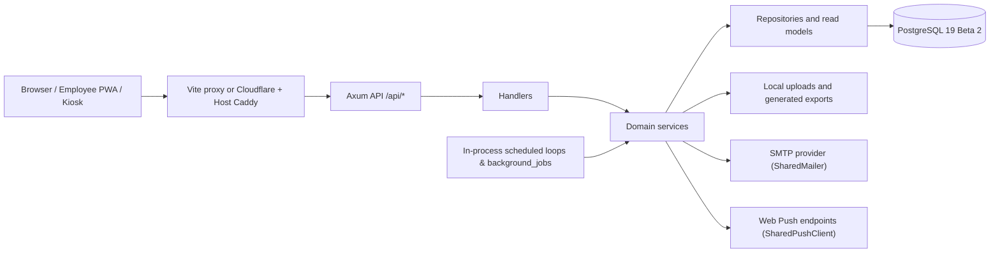

# System architecture

This is the living architecture reference for the implemented payroll and HR system. Feature completeness and known gaps are tracked in [features.md](features.md), the database baseline and migration contract in [database.md](database.md), the payroll subsystem in [payroll.md](payroll.md), localization rules in [i18n.md](i18n.md), and regulatory/PDPA governance in [legal.md](legal.md).

## System context

The React single-page application calls one Axum API. During development Vite proxies `/api`; in production Cloudflare fronts the AIC VPS, where host Caddy serves the built static PWA from `/opt/payrollmy-site` (reference config in [deploy/payrollmy-site.Caddyfile.example](../deploy/payrollmy-site.Caddyfile.example)) and reverse-proxies `/api` to the API container on `127.0.0.1:8080`. All backend routes are declared in [backend/src/routes/mod.rs](../backend/src/routes/mod.rs).

## Backend boundaries

| Layer                 | Responsibility                                                                                             |
| --------------------- | ---------------------------------------------------------------------------------------------------------- |
| `handlers/`           | HTTP extraction, authentication context, permission checks, validation, and response mapping               |
| `services/`           | Business rules, workflow orchestration, transaction boundaries, and audit intent                           |
| `repositories/`       | One-table SQL operations, generic over `impl sqlx::Executor<'_, Database = Postgres>`                      |
| `repositories/reads/` | Cross-table projections, reports, and denormalized read models                                             |
| `models/`             | API/domain structures and SQLx result projections                                                          |
| `core/`               | Configuration, database pool/migrator, JWT & permissions, Turnstile, SSRF/path guards, cookies, `AppState` |

Request-time SQL belongs strictly in `repositories/` and `repositories/reads/`. A service passes `&PgPool` or composes multiple repository calls inside one `&mut Transaction`. `AppState` shares `{ pool, config, webauthn, mailer, push }`. `AppResult<T>` is the common error boundary; `sqlx::Error` converts to `AppError::Database`, while `AppError::Internal` is logged and returned as a generic HTTP 500.

## Background workers and async jobs

The API process owns **four scheduled background loops** in `backend/src/main.rs` plus an in-process **`background_jobs` async executor** (`202 Accepted` + `GET /api/jobs/{id}` polling for `payroll_run` and `employee_import`, with boot-time recovery marking interrupted in-flight jobs failed):

1. **Daily PDPA retention cleanup** (24-hour interval, PostgreSQL advisory lock `7_492_026_101`): purges expired/revoked `refresh_tokens` (>30 days), unreferenced expired `attendance_qr_tokens` (>7 days), aged `attendance_network_observations` (`OBSERVATION_RETENTION_DAYS`), expired network dismissals, `audit_logs` older than 7 years (`2,555` days per _Income Tax Act 1967 s.82_), `notifications` (90 days read / 365 days unread), `email_logs` (>180 days), `user_sessions` (30 days revoked / 90 days inactive), expired `bulk_import_sessions`, `password_reset_requests` (>30 days), expired `passkey_challenges`, expired `oauth2_states`, finished `background_jobs` (>30 days), unreferenced `uploaded_files` (>24 hours), stale `push_subscriptions` (30 days revoked / 180 days inactive), and old `push_outbox` rows (>30 days).
2. **Daily auto-absent catch-up** (04:30 UTC / 12:30 PM MYT via `core::schedule::next_daily_run_utc`, plus once at startup, advisory lock `7_492_026_102`): evaluates each company in its own validated IANA timezone from its last bookmarked run date (capped at 14 days), skipping approved `leave_requests`, non-working days, and public holidays.
3. **Transactional email outbox worker** (15-second tick, batch size 25 using `FOR UPDATE SKIP LOCKED` and exponential backoff): delivers queued messages through `AppState.mailer` (`SharedMailer`).
4. **Web Push outbox worker** (5-second tick, batch size 50 using `FOR UPDATE SKIP LOCKED`, retry backoff `[30s, 120s, 600s]`, max 4 attempts): encrypts RFC 8291 AES-128-GCM payloads and signs RFC 8292 VAPID ES256 headers via `AppState.push` (`SharedPushClient`), automatically revoking subscriptions on `404`/`410`.

Each background loop records heartbeats via `job_health_service` into `platform_settings`, surfaced in sanitized form on `GET /api/health/ready` and in detail on `GET /api/admin/platform/health` (`super_admin`). Advisory locks and atomic `background_jobs` claiming support safe coordination, while in-process job execution remains geared toward a single active API instance.

## Identity, roles, tenancy, and abuse controls

Access tokens are HS256 JWTs carried as `Authorization: Bearer` tokens and held **in memory only** on the frontend. Refresh tokens are opaque, rotated atomically with reuse detection, SHA-256 hashed in PostgreSQL, and stored in an `httpOnly` cookie (`localStorage` mirrors display profile metadata only).

Canonical roles (`core::permission::ALL_ROLES`, enforced by `users_roles_valid`):

`super_admin`, `admin`, `manager`, `payroll_admin`, `hr_manager`, `finance`, `exec`, `employee`

- **`manager`** (`1031_manager_role.sql`) holds all company-management capabilities except payroll capabilities (`is_payroll_capability`) and `import_employees` (it keeps `view_audit_log`, with payroll and `bank_*` audit keys redacted), excludes platform-only grants (`manage_users`, `manage_companies`, `manage_backups`, `manage_platform_settings`), and hides `admin`/`super_admin` accounts in user-directory and group-member views (`user_service::hides_privileged_users`).
- **Additive `user_groups`** combine with role grants per request via `filter_group_permissions_for_roles`, which strips platform-only capabilities for all groups, strips payroll capabilities for `exec`/`employee`/`manager`, and keeps `exec`-only users strictly read-only.
- **Multi-company context** is carried in the JWT `company_id` claim and switched via `PUT /api/auth/switch-company`. Every tenant-owned lookup requires company scope; composite `(parent_id, company_id)` foreign keys and immutable `company_id` triggers reinforce tenancy below the service layer.
- **MFA & Bot/Rate Controls**: TOTP 2FA secrets are encrypted with a dedicated `TOTP_ENCRYPTION_KEY` (with step anti-replay and brute-force lockout), alongside backup recovery codes (`code_lookup_hash` O(1) index), WebAuthn passkeys, Google OAuth2 (with browser-bound state cookies), and Cloudflare Turnstile (`core::turnstile::verify`, fail-closed when `TURNSTILE_SECRET_KEY` is set). Rate limiting (`tower_governor` with periodic pruning) applies `ClientIpKeyExtractor` (gated by `TRUST_PROXY_HEADERS`) to unauthenticated endpoints and `SessionOrIpKeyExtractor` to expensive authenticated routes, paired with explicit `DefaultBodyLimit` bounds on `/uploads`, `/admin/backup/import`, `/employees/import/validate`, and `/calendar/import-ics-file`.
- **Bootstrap**: Fresh databases contain no login credentials; the one-time `bootstrap_admin` CLI creates the first company and `super_admin` account.

## Payroll, attendance, and operational workflows

- **Payroll**: See [payroll.md](payroll.md) for the complete calculation engine, `StatutoryTables` snapshot, `taxable_gross` / `calculation_snapshot`, run lifecycle (`processing` → `processed` → `pending_approval` → `approved` → `paid` / `cancelled`), four-eyes approval, and fail-closed statutory gates.
- **Attendance**: Supports multi-use expiring QR tokens scoped per kiosk/admin surface (`used` = administratively revoked), server-verified WebAuthn ("Face ID") check-in, 24-hour overnight check-out (never blocked by geofence), `none`/`warn`/`enforce` geofencing, `none`/`learn`/`warn`/`enforce` office-network binding (`core::client_ip`, anchored proposals without exposing `employee_id → IP` mappings), self-healing per-timezone auto-absent catch-up, distinct-day summary read models, audited corrections, and CSV export.
- **Employee & Approvals**: Core HR, salary history (`change_type`), TP3, async CSV/XLSX bulk import, portal leave/claim/overtime submissions, maker-checker approval workbenches, company default provisioning (`provision_company_defaults`), document management (`uploaded_files` + `core::upload_path` reverse-reference authorization), SSRF-hardened ICS calendar import (`core::http_client`), and company JSON backup/restore.

## Frontend structure, PWA, and i18n

`frontend/src/App.tsx` centralizes routes in `lib/routes.ts` (`ROUTES`) across two lazy-loaded shells:

- `AppLayout` for administration, HR, payroll, reports, attendance, and `/account` (`AccountSecurityPage`) / `/admin/platform` (`PlatformSettingsPage`);
- `PortalLayout` for employee self-service (`/portal/profile`, `/portal/payslips`, `/portal/leave`, `/portal/claims`, `/portal/overtime`, `/portal/team-calendar`, `/portal/notifications`, `/portal/attendance`).

Public routes cover `/login`, `/oauth2/callback`, `/oauth2/link`, `/forgot-password`, `/reset-password`, `/change-password`, `/attendance/scan` (auth-guarded check-in), `/kiosk#<secret>` (fragment-scrubbed kiosk display; legacy `/kiosk/:kioskKey`), `/terms`, `/privacy`, and `/compliance`.

`frontend/src/api/client.ts` is the sole Axios client (single queued 401 refresh, 30s React Query `staleTime`, `OfflineBanner`, `RouteErrorBoundary`, global `MutationCache` error toast). `PwaProvider`, `frontend/public/manifest.webmanifest`, `frontend/public/sw.js`, and `offline.html` deliver installability across iOS Safari, Android, and desktop plus Web Push subscription management (`AppInstallCard`, `NotificationActivationCard`). All UI copy and mapped server errors support `en`, `ms`, `zh-CN`, and `zh-TW` ([i18n.md](i18n.md)).

## Data, deployment, and backups

- **Database**: Consolidated `1000_schema.sql` + `1001_data.sql` baseline and immutable forward migrations `1002`–`1034` on **PostgreSQL 19 Beta 2** ([database.md](database.md)).
- **Deployment**: GitHub Actions workflows (`ci.yml`, `deploy.yml`, `deploy-backend.yml`) trigger on `main` and `master`. Production builds the static SPA to `/opt/payrollmy-site` (host Caddy) and ships a checksummed `linux/amd64` Docker image (`infra/Dockerfile`) to the AIC VPS behind Cloudflare.
- **Backups & Monitoring**: Since the 2026-09-25 AWS decommission, `deploy/payroll-backup.sh` creates nightly local `pg_dump --format=custom` backups verified via `pg_restore --list` (retaining 14 dumps in `/opt/payroll/backups`), and `deploy/payroll-watchdog.sh` monitors `/api/health/ready` and disk usage.
- **Uploads**: Stored on the API container's local `uploads/` bind mount, tracked in `uploaded_files`, and served only after per-user reverse-reference authorization (`404` on denial).

## Architectural invariants

- Keep handlers thin and put business rules in `services/`.
- Keep request-time SQL in `repositories/` or `repositories/reads/`.
- Gate every handler explicitly with allow-list `Permission` checks and enforce `company_id` scope on every tenant-owned lookup.
- Use `rust_decimal::Decimal` and integer `sen` (`i64`) for money, never `f64`.
- Interpret business dates and attendance schedules in the company's validated IANA timezone (`Asia/Kuala_Lumpur` default); store instants as UTC `timestamptz`.
- Preserve payroll and attendance state-machine checks at both service and database boundaries.
- Extend `frontend/src/api/client.ts` rather than introducing a second HTTP client or parallel auth state.
